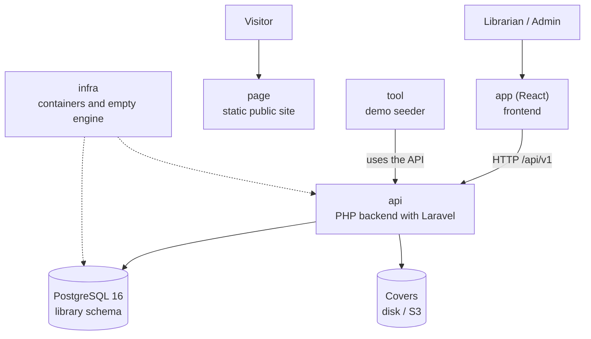

# Architecture in one page — Manager Library

To read in five minutes before opening the rest. The detail is in [`architecture.md`](architecture.md).

## The system in one picture

## The six repositories and their role

| Repo | Role | Tested with |
|---|---|---|
| `docs` | The specification | That this reading is enough to build |
| `api` | Business rules and HTTP contract | Domain, application, contract and concurrency tests |
| `app` | Operation screens | An end-to-end walkthrough: login → lend → return → report |
| `page` | Public presentation, without calling the API | That it looks good on mobile and desktop |
| `infra` | `docker compose up` and the empty database | That it starts with a single command |
| `tool` | Demo data (books, members, loans) | That the demo fair has real data |

## The five ideas behind the design

1. **The loan is an immutable fact**; only `returned_at` of a line changes.
2. **Copies are deducted and returned within the same operation** that creates or closes the line.
3. **State is computed**: `open`, `overdue` or `closed` are not in the database.
4. **Frozen data does not follow the catalog**: the October report does not change because a book is renamed in November.
5. **The database is the last barrier**: if the copy `CHECK` fires, something wrote outside the system.
